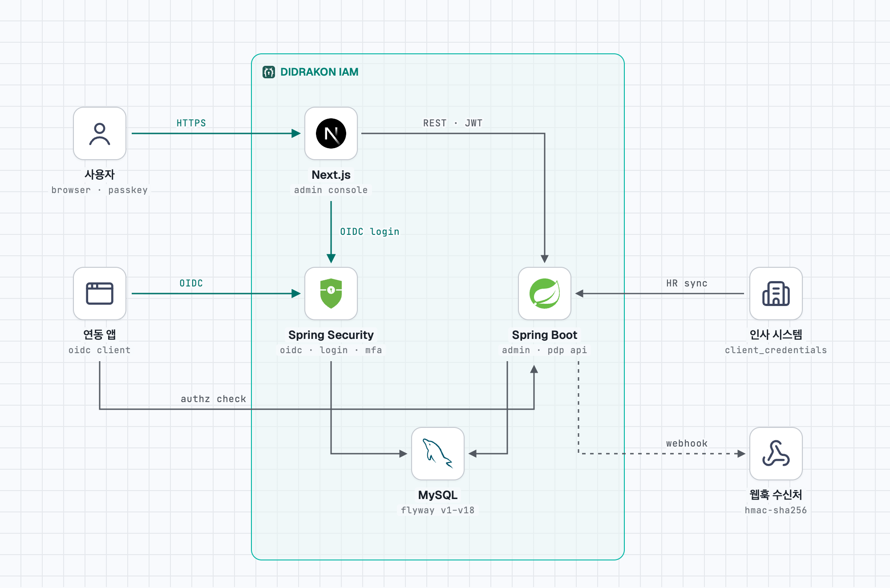

# DIDRAKON IAM

An identity and access management platform: single sign-on (OIDC), authorization (RBAC + ABAC + ReBAC), access governance, risk scoring and audit.

The name comes from Greek *di* (two) + *drakōn* (dragon): two dragons, authentication and authorization, guarding the gate.

It is built for organizations shaped like Korean companies — employee numbers, an HR system as the source of truth, org-scoped administrators, and periodic access reviews with evidence — but works as a general-purpose IAM.

> The primary documentation is in Korean: [README.md](README.md) (full reference), [docs/erd-v2.md](docs/erd-v2.md) (data model and rules), [docs/integration/README.md](docs/integration/README.md) (integration guides and verified example apps). This page is an English overview.

## Architecture

<picture>
  <source media="(prefers-color-scheme: dark)" srcset="docs/architecture-dark.png">
  
</picture>

Users and relying applications sign in through the authorization server with OIDC. The admin console, relying applications and the HR system call the management and authorization-check APIs. Both run in one process (`:8080`) on one MySQL database. Changes are pushed out through webhooks and OIDC back-channel logout.

## Features

- **Sign-in**: OIDC/OAuth 2.1 (Spring Authorization Server), local accounts with lockout, TOTP, passkeys (WebAuthn), API keys, self-service password reset with an authenticator app, sessions stored in the database (Spring Session JDBC).
- **Authorization**: a policy decision point combining roles (with organization/resource scopes), ABAC policies with versioned rules and exceptions, and organization/group role rules. Other systems ask `POST /api/v1/authz/check`.
- **Governance**: just-in-time access requests with approval policies, separation of duties, delegation, break-glass access, and access review campaigns with CSV evidence.
- **Organizations**: org tree, memberships, groups, internal employees and external (B2B) users, HR sync with dry run (hire, move, leave, retire).
- **Risk**: login and access risk signals (new device, foreign IP, unusual time, failed-login burst, mass access) that can deny or require step-up.
- **Audit**: every change to reference data, role assignments and policies is recorded with before/after values; changes are also delivered to subscribers through signed webhooks.
- **Admin console**: Next.js backend-for-frontend; tokens never reach the browser. Includes an in-console developer integration guide.

## Repository layout

```
didrakon-iam/
├── backend/            Kotlin + Spring Boot 4.1 (Gradle multi-module)
│   ├── iam-common      shared base entities, errors, request context
│   ├── iam-identity    subjects, users, organizations, groups, identity providers
│   ├── iam-authn       authorization server (OIDC), login, sessions, MFA, passkeys, API keys
│   ├── iam-authz       policy decision point
│   ├── iam-governance  JIT, approvals, SoD, delegation, break-glass, access reviews
│   ├── iam-risk        risk policies, signals and assessments
│   ├── iam-audit       audit events and change history
│   └── iam-app         runnable app: REST API, security config, bootstrap, schedulers, webhooks, Flyway
├── admin/              Next.js admin console
├── examples/           integration example apps
└── docker-compose.yml  local MySQL 8.4
```

Modules talk to each other through domain events handled synchronously in the same transaction; a publishing module never depends on its subscribers.

## Security model (summary)

- `/api/**` accepts only IAM-issued JWTs minted for the admin console, client-credentials tokens, or `X-API-Key`. Every handler must declare `@RequiresPermission` (checked by IAM's own PDP) or `@SelfService`; anything else is denied.
- Admin APIs require MFA (`amr` containing `otp` or `hwk`) through a built-in policy that cannot be switched off, retargeted or excepted from the console or API.
- Org-scoped administrators manage only people and units inside their organization subtree and can never change people who hold, or are about to receive, console permissions.
- Logout, session revocation, password change, disabling and retirement revoke the related sessions, refresh tokens and API keys. Refresh tokens stop working when the login session that issued them ends (8 hours absolute).
- Per-IP rate limits for login, token and API endpoints.

See [README.md](README.md) for the full table of security chains, token claims and API paths.

## Quick start

Requirements: JDK 25 (downloaded by the Gradle toolchain), Docker, Node.js with pnpm.

```bash
cp .env.example .env
```

Set `IAM_SECRET_KEY` (used to encrypt MFA secrets) in `.env`, for example with:

```bash
openssl rand -base64 32
```

To create the first administrator, also set `IAM_BOOTSTRAP_ADMIN_LOGIN` and `IAM_BOOTSTRAP_ADMIN_PASSWORD` before the first start.

```bash
docker compose up -d
```

```bash
cd backend && set -a && source ../.env && set +a && ./gradlew :iam-app:bootRun
```

The `local` profile seeds a fictional company with demo employees and roles on first start (`iam.demo-data.enabled` turns it off).

For the admin console, copy `admin/.env.example` to `admin/.env.local`, fill in `SESSION_SECRET`, then:

```bash
cd admin && pnpm install && pnpm dev
```

Open http://localhost:3000, sign in as the administrator, register an authenticator app under **2단계 인증** (two-step verification), sign out and sign in again. Admin APIs then become available.

In production (`prod` profile) the server refuses to start without a fixed JWT signing key pair (`IAM_JWT_PRIVATE_KEY`, `IAM_JWT_PUBLIC_KEY`; see `.env.example`). Passkeys need HTTPS outside `localhost`.

## Build and test

Tests start MySQL 8.4 with Testcontainers, so Docker must be running.

```bash
cd backend && ./gradlew build
```

```bash
cd admin && pnpm build && pnpm lint
```

## Security

Please report vulnerabilities privately as described in [SECURITY.md](SECURITY.md). Do not open public issues for them.

## License

[Apache License 2.0](LICENSE)
