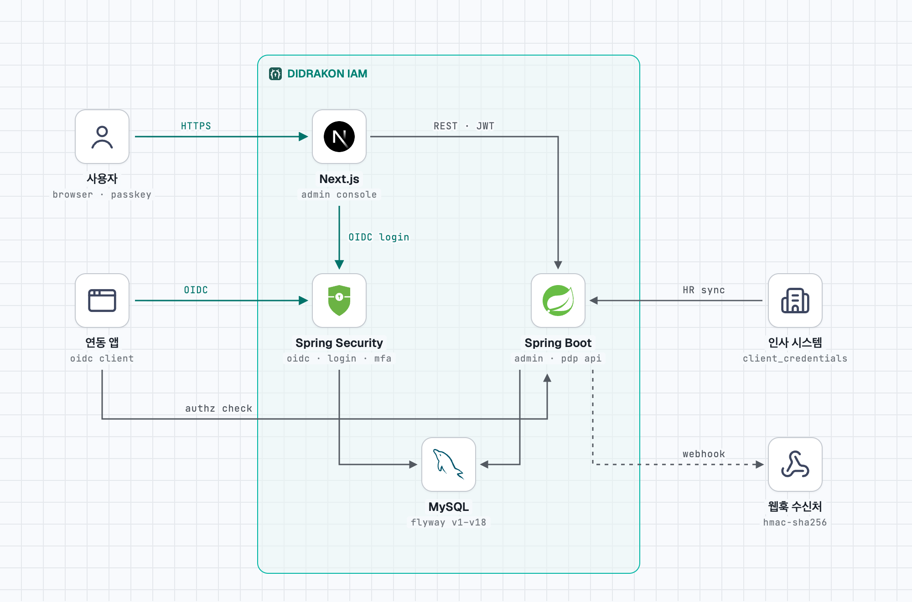

# DIDRAKON IAM

범용 IAM 플랫폼: 인증(SSO), 인가(RBAC + ABAC + ReBAC), 권한 거버넌스, 위험 평가, 감사.

이름은 그리스어 *di*(둘) + *drakōn*(용), "두 마리 용"에서 왔다. 인증과 인가, 두 용이 문을 지킨다.

English: [README.en.md](README.en.md) · 설계 문서: [docs/erd-v2.md](docs/erd-v2.md) · 다른 시스템 연동: [docs/integration/README.md](docs/integration/README.md) (스택별 빠른 시작, 데이터 이관, 검증한 예제 앱)

## 시스템 구조

<picture>
  <source media="(prefers-color-scheme: dark)" srcset="docs/architecture-dark.png">
  
</picture>

사용자와 연동 앱은 로그인·인가 서버에서 OIDC 로 로그인하고, 관리 콘솔·연동 앱·인사 시스템은 관리·권한 판정 API 를 부른다. 두 서버는 한 프로세스(:8080)에서 같은 MySQL 을 쓰며, 변경은 웹훅과 back-channel 로그아웃으로 바깥에 알린다. 원본 HTML([stack-diagram](https://github.com/caru-ini/stack-diagram) 으로 만듦): [docs/architecture.html](docs/architecture.html)

## 구성

```
didrakon-iam/
├── backend/            Kotlin + Spring Boot 4.1 (Gradle 멀티모듈)
│   ├── iam-common      공통 (BaseEntity, 예외, 요청 컨텍스트, hash)
│   ├── iam-identity    Subject, User, Organization, Group, IdP
│   ├── iam-authn       Authorization Server (OIDC), 로컬 로그인·잠금, 세션, MFA(TOTP), 패스키(WebAuthn), API 키
│   ├── iam-authz       권한 판정 엔진 (PDP)
│   ├── iam-governance  JIT, 승인, SoD, 위임, Break-glass
│   ├── iam-risk        위험 정책·신호·평가 (로그인·권한 판정·접근 요청에 점수 제공)
│   ├── iam-audit       감사 이벤트, 역할·정책 변경 이력 (다른 모듈 이벤트의 최종 소비자)
│   └── iam-app         실행 모듈 (REST API, 보안 설정, 초기 구성, 만료 스케줄러, 외부 webhook, Flyway)
├── admin/              Next.js 관리 콘솔
└── docker-compose.yml  로컬 MySQL 8.4
```

모듈 의존 방향: `governance → authz → identity → common`, `authn → identity`, `risk → identity`, `authn·authz·governance → risk`, `audit → authn·governance·risk`, `app → 전체`

모듈 간 연동은 도메인 이벤트로 한다. 발행 모듈은 구독 모듈을 모르고, 이벤트는 같은 트랜잭션 안에서 동기적으로 처리된다.

| 이벤트 (발행 모듈) | 구독 |
|---|---|
| 소속 변경·전적·조직 이동·그룹 구성원 변경 (identity) | authz: 조직·그룹 역할 할당 동기화, 전적 처리 / audit: MEMBERSHIP_CHANGE |
| 역할 할당 변경 (authz) | audit: ROLE_CHANGE_HISTORY, ROLE_CHANGE |
| 정책 버전 활성화 (authz) | audit: POLICY_CHANGE_HISTORY, POLICY_CHANGE |
| 역할 할당 회수·만료 (authz) | governance: 그 역할로 한 위임 종료 |
| 로그인·로그아웃·MFA (authn) | audit: LOGIN, LOGOUT |
| 접근 요청·비상 접근·위임·접근 재검토 (governance) | audit: JIT, ROLE_CHANGE / governance: 승인된 비상 접근 세션 시작 |
| 사용자 상태 변경 — 사용 중지·잠김·퇴사 (identity) | authn: 로그인 세션 종료, 발급 토큰 회수, API 키 폐기 / authz: 퇴사면 남은 역할 할당 전부 회수 |
| 기준 데이터 수정·켜기·끄기 (identity·authz·governance·authn) | audit: 전후 값과 함께 AUDIT_EVENT |
| 위험 정책 변경 (risk) | audit: POLICY_CHANGE (RISK_POLICY) |
| 사용자 상태·소속·그룹 구성원·역할 할당·접근 요청·기준 데이터 변경 (identity·authz·governance·common) | app: 외부 webhook 아웃박스(`webhook_delivery`)에 전달 행 기록 → 커밋 뒤 전달 작업이 연동 시스템에 보냄 |

authz 는 governance 를 모르므로, 직무 분리(SoD)는 authz 의 `RoleGrantGuard` 를 governance 가 구현해 모든 부여 경로에 끼운다.

감사 기록의 행위자·IP·trace 는 `RequestContextHolder`(iam-common)에서 읽는다. `/api` 요청은 필터가 채우고, 비어 있으면 시스템 작업으로 기록된다.

## 보안 구조

| 경로 | 보안 체인 | 인증 | 인가 |
|---|---|---|---|
| `/oauth2/**`, `/.well-known/**`, `/userinfo` 등 | 1. Authorization Server | 클라이언트 인증, 로그인 세션 | SAS |
| `/api/**` | 2. 리소스 서버 (세션 없음) | IAM 이 발급한 JWT 또는 `X-API-Key`. 사람의 토큰은 관리 콘솔(`iam-admin`)에 발급된 접근 토큰만 받고, 다른 연동 시스템이 받은 토큰과 ID 토큰은 거부한다. 시스템 간 토큰(client credentials)은 받는다 | 핸들러의 `@RequiresPermission` → IAM 자신의 PDP (`orgOf` 로 대상 사용자·조직·소속·세션의 조직을 함께 넘김). `@SelfService` 는 본인만(사용 중인 계정만). 둘 다 없으면 거부 |
| `/login`, `/login/mfa`, `/login/password`, `/login/forgot`, `/logout` | 3. 로그인 | 폼 로그인 + TOTP, 만료·초기화된 비밀번호는 변경 후 재로그인, 비밀번호를 잊었으면 인증 앱 코드로 셀프 재설정(잠금도 풀림) | 로그인 세션 |
| `/login/webauthn`, `/webauthn/**`, `/account/passkeys` | 3. 로그인 | 패스키 로그인(Spring Security WebAuthn), 패스키 등록·관리 화면 | 등록·삭제는 2단계 인증을 거친 로그인만 |
| `/`, `/account/sessions/revoke-others` | 3. 로그인 | IAM 홈(내 계정): 내 앱 바로가기(앱 시작 주소를 둔 켜진 클라이언트), 계정 보안 바로가기(패스키, 콘솔의 2단계 인증·내 정보), 로그인된 기기와 다른 기기 모두 로그아웃, 최근 로그인 기록 10건. 이미 로그인한 사람이 `/login` 을 직접 열면 여기로 온다 | 본인 |

- 토큰의 `sub` 는 subject ID, `amr` 은 인증 방법(RFC 8176)이다: 비밀번호 `[pwd]`, 비밀번호 + 인증 앱 `[pwd, otp]`, 패스키 `[hwk, user]`. 사용자 토큰에는 `name`, `user_kind`(내부 `EMPLOYEE`·외부 `EXTERNAL`), `emp_no`(임직원만), `primary_org_id`, `company_org_id`, `roles` 도 들어간다. 토큰 수명(접근 10분) 동안은 바뀐 값이 반영되지 않으므로 메뉴 노출 같은 거친 판단에만 쓰고, 세밀한 판단은 `/api/v1/authz/check` 로 한다.
- 브라우저 로그인 세션(HTTP 세션)은 DB 에 저장한다(Spring Session JDBC, `SPRING_SESSION`·`SPRING_SESSION_ATTRIBUTES`, V22). 서버를 다시 띄우거나 여러 대로 운영해도 로그인이 유지된다. 30분 쓰지 않으면 끝나고, 로그인 세션 자체는 8시간이면 끝난다(`iam.authn.session-timeout`). 그 세션에서 받은 refresh token 도 세션이 끝나면 새 토큰을 받지 못한다(`invalid_grant`). 세션에 넣는 값은 직렬화할 수 있어야 하고, 로그인 실패 예외에서 입력한 비밀번호는 지운 뒤 저장한다.
- 토큰은 발급될 때 로그인 세션과 연결된다. 로그아웃·세션 종료는 그 세션의 refresh token 을, 사용 중지·퇴사는 그 사람의 모든 토큰·세션·API 키를, 비밀번호 변경(본인·셀프 재설정·관리자 초기화)은 모든 세션·토큰을 회수한다. 접근 토큰(JWT)은 만료까지 남지만 PDP 가 사용 중이 아닌 사용자를 거부한다.
- 토큰을 회수할 때, back-channel 로그아웃 주소를 등록한 연동 시스템에는 서명한 로그아웃 토큰(OIDC Back-Channel Logout, `typ: logout+jwt`, `sub`)을 커밋 뒤 보낸다. 로그인 세션 하나가 끝난 것이면 ID 토큰과 같은 `sid` 도 넣으므로 연동 시스템은 그 세션만 끝내고, 사용자 단위(사용 중지·잠금·퇴사)면 `sub` 로 그 사용자의 세션을 모두 끝낸다.
- IP 별 호출 수 제한(1분): 로그인 20, 토큰 120, 권한 판정 6000, 그 밖의 API 600 (`iam.rate-limit.*`). 기본은 서버별 메모리 카운터이고, 여러 대로 운영하면 `iam.rate-limit.store: jdbc` 로 로그인·토큰 경로를 DB 에서 함께 센다. 운영은 프록시가 넘긴 실제 IP 를 쓴다 (`forward-headers-strategy: native`).
- 로그인 위험 평가: DENY 는 막고(`/login?risk`), CHALLENGE·APPROVAL 은 추가 인증을 요구한다. 확인된 TOTP 가 있으면 MFA 단계로 보내고, 없으면 막는다(`/login?challenge`, 실패 횟수는 그대로). `iam.risk.block-challenge-without-mfa: false` 면 기록만 하고 들여보낸다. 패스키 로그인은 그 자체로 추가 인증을 충족한 것으로 보고 위험 신호만 기록한다 (DENY 는 패스키도 막는다).
- 패스키(WebAuthn, 피싱 방지·비밀번호 없는 로그인): 로그인 화면의 `패스키로 로그인`이 Spring Security 의 WebAuthn 엔드포인트(`/webauthn/authenticate/options` → `/login/webauthn`)를 부른다. 사용자 확인(생체·PIN)을 필수로 요구하므로 패스키 로그인은 MFA 다: 세션은 MFA 수준, MFA 필수 클라이언트와 관리 API MFA 정책을 통과하고 TOTP 를 다시 묻지 않는다. 성공 뒤 처리(위험 평가, 로그인 세션, 인증 이벤트 사유 `PASSKEY`, 감사)는 비밀번호 로그인과 같고, 비밀번호 실패 횟수는 건드리지 않는다. 사용 안 함·퇴사·잠김 계정과 비밀번호·코드 실패로 일시 잠긴 계정은 막는다(`/login?unavailable`). 2단계 인증 수단이 패스키뿐인 사람은 비밀번호만으로 로그인할 수 없고 패스키로 로그인해야 한다(`/login?passkey-required`, 실패 횟수는 그대로). 패스키를 잃어버리면 관리자가 초기화한다.
- 2단계 인증 수단(인증 앱·패스키)을 더하거나 지우는 `/api/v1/me/mfa/**`·`DELETE /api/v1/me/passkeys/{id}` 는 로그인한 본인 토큰만 쓴다(API 키는 403). 이미 인증 앱이나 패스키가 있으면 MFA(`otp`) 또는 패스키(`hwk`)로 로그인한 토큰이어야 한다(아니면 401 `MFA_REQUIRED`). 이 수단으로 비밀번호 재설정과 로그인을 하므로, 첫 등록만 비밀번호 로그인으로 할 수 있다.
- 패스키 등록·삭제는 IAM 화면 `/account/passkeys` 에서 하고, 2단계 인증(인증 앱 또는 패스키)을 거친 로그인만 할 수 있다 (비밀번호만 훔친 사람이 패스키를 심지 못하게). 비밀번호로만 로그인했고 인증 앱이 있으면 코드를 받은 뒤 돌아오고, 로그인 전에 열었으면 로그인 뒤 이 화면으로 돌아온다. 콘솔 `2단계 인증` 화면에 목록·삭제와 이 화면으로 가는 링크가 있다. 등록·삭제는 감사(LOGIN, `PASSKEY_ADD`·`PASSKEY_REMOVE`)에 남는다. WebAuthn 사용자 이름은 subject ID 다 (`user_entities`·`user_credentials`).
- 해외 IP 신호(FOREIGN_IP)는 `iam.risk.geoip-database`(MaxMind GeoLite2/GeoIP2 Country `.mmdb` 경로, 환경변수 `IAM_GEOIP_DATABASE`)나 `iam.risk.ip-country-overrides`(CIDR → 국가 코드, DB 보다 먼저 본다)를 넣었을 때만 잡힌다. 사설·루프백 주소와 찾지 못한 주소는 국가를 모르는 것으로 보고 신호를 만들지 않는다.
- 관리 API MFA 정책(`IAM_ADMIN_API_MFA`)은 콘솔·API 로 끄거나, 대상·규칙을 바꾸거나, 예외를 둘 수 없다(409). 켜고 끄기는 설정(`iam.bootstrap.require-mfa-for-admin`)으로 한다. 다른 정책의 예외 추가는 감사(`ADD_EXCEPTION`)에 남는다.
- 기동 시 `IamBootstrap` 이 관리 콘솔 클라이언트(`iam-admin`), IAM 자체 리소스·권한, 역할(`IAM_ADMIN`, `IAM_AUDITOR`, `IAM_ORG_ADMIN`, `IAM_AUTHZ_CLIENT`, `IAM_HR_SYNC`), 관리 역할 MFA 정책을 만든다 (여러 번 실행해도 같다).
- 조직 단위 관리자: 전체 관리자가 `IAM_ORG_ADMIN` 을 ORGANIZATION 범위(하위 포함)로 할당하면, 그 조직 안의 사람·소속·조직·세션만 관리한다. 목록도 범위 안만 보이고, 역할·정책 등 전체 전용 API 는 403 이며 다른 관리자는 바꿀 수 없다 (역할을 줄 수 없음. 관리 콘솔 권한이 있는 역할은 조직·그룹 역할 규칙으로 줄 수 없어 소속을 바꿔 관리 역할을 얻을 수도 없다. 규칙은 [docs/erd-v2.md](docs/erd-v2.md) "조직 단위 관리 규칙").
- 사용자 구분: 내부 임직원(`EMPLOYEE`, 사번 필수)과 외부 사용자(`EXTERNAL`, 예: B2B 고객사 사용자. 사번 없이 이메일로 식별하고 고객사 조직에 소속). 외부 사용자는 HR 연동 대상이 아니다. ABAC 규칙에서는 SUBJECT `userKind` 로 구분한다.
- 다른 시스템의 권한 판정은 `POST /api/v1/authz/check` 로 한다. `iam.authz.check` scope 를 가진 client credentials 토큰이나, `IAM_AUTHZ_CLIENT` 역할 서비스 계정의 API 키를 쓴다.
- 인사 시스템은 `POST /api/v1/hr/sync` 를 `iam.hr.sync` scope 를 가진 client credentials 토큰이나, `IAM_HR_SYNC` 역할 서비스 계정의 API 키로 부른다 (규칙은 [docs/erd-v2.md](docs/erd-v2.md) "HR 연동 규칙").

## API

모든 응답은 `{"success", "data", "error": {"code", "message", "fields"}}` 형식이다. 요청에 `X-Trace-Id` 를 넣으면 감사 기록에 남고 응답 헤더로 돌아온다.

| 영역 | 경로 |
|---|---|
| 사용자·조직·소속·그룹 | `/api/v1/users`(`?q=`(이름·사번·이메일)`&kind=EMPLOYEE\|EXTERNAL`, 생성은 `userKind`·`primaryOrgId` 로 주 소속까지), `/users/{id}/password`(관리자 초기화, 다음 로그인에 변경 강제), `/users/{id}/credential`(로그인 ID·잠금·비밀번호 상태), `POST /users/{id}/login-account`(로그인 계정이 없는 사람에게 만들기, 다음 로그인에 변경 강제), `/users/{id}/unlock`(관리자 잠금 해제, 비밀번호 유지), `/users/{id}/retire`(퇴사. 미래 날짜면 예약, `DELETE` 로 예약 취소), `POST /users/lookup`(연동 시스템 계정 연결용: 사번·이메일 목록 → subject ID, 전체 범위 조회 권한만), `/organizations`, `/memberships`(`PUT /memberships/{id}`: 직위·직급·조직 관리자 변경), `/subjects/{id}/primary-membership`, `/groups` |
| 리소스·역할·권한·scope | `/api/v1/resources`, `/roles`, `/permissions`, `/scopes` |
| 할당·조직/그룹 역할 규칙 | `/api/v1/assignments`(`PUT /assignments/{id}`: 직접 할당 만료일 변경), `/subjects/{id}/assignments`, `/organization-roles`, `/group-roles` |
| 정책 | `/api/v1/policies`, `PUT /policies/{id}/targets`(대상 바꾸기, 다음 판정부터 적용), `/policies/{id}/versions`, `/policy-versions/{id}/activate`, `/policies/{id}/exceptions` |
| 권한 판정 | `POST /api/v1/authz/check` |
| 승인·직무 분리·비상 접근·위임 | `/api/v1/access-requests`(`/pending`, `/history`: 처리 시각 `closedAt` 포함), `/role-conflicts`(`PUT` 으로 심각도·설명 변경, 역할 쌍은 그대로), `/break-glass-policies`(목록·추가·수정·켜기/끄기. 대상 그룹(`eligibleGroupId`)을 정하면 그 그룹 구성원만 시작할 수 있고, 비우면 사용 중인 사람 누구나. 관리 콘솔 권한이 있는 역할은 `승인 후 시작`만 된다. `/group-options` 는 그룹 선택지), `/break-glass-sessions`(목록, `/{id}/end` 관리자 종료), `/delegations`(목록, `/{id}/revoke` 관리자 회수) |
| 접근 재검토 | `/api/v1/access-reviews`(목록·시작), `GET /access-reviews/{id}?decision=`(항목), `POST /access-reviews/{id}/close`(마감), `GET /access-reviews/{id}/export`(증적 CSV, UTF-8 BOM), `POST /access-review-items/{id}/decide`(관리자 결정) |
| 수정·켜기·끄기 | `PUT` `/api/v1/{users,organizations,groups,roles,resources,permissions,scopes,policies,clients}/{id}`, 같은 경로 + `/activate`·`/deactivate`, `DELETE /role-permissions/{id}`·`/policy-exceptions/{id}`·`/role-conflict-exceptions/{id}` |
| 위험 정책·평가 | `/api/v1/risk-policies`, `/risk-policies/{id}/activate`·`deactivate`, `/subjects/{id}/risk` |
| 클라이언트·세션·API 키·인증 수단 | `/api/v1/clients`(리다이렉트·로그아웃 뒤 주소·scope·기밀 여부 포함. `PUT` 으로 주소·scope 도 바꾼다(client_id 그대로, `iam-admin` 의 로그인 설정은 못 바꿈). back-channel 로그아웃 주소, Supabase 호환(`supabaseRoleClaim`: 토큰에 `role: authenticated`)), `POST /clients/{id}/rotate-secret`(비밀값 재발급, 응답에서 한 번만), `/subjects/{id}/sessions`(`DELETE` 면 모든 세션·토큰 회수), `/sessions/{id}`, `/subjects/{id}/api-keys`(목록·발급, 폐기 시각 포함. 발급·폐기는 감사에 키 주인을 대상자로 남긴다), `/api-keys/{id}`(폐기), `/subjects/{id}/mfa`(인증 앱·패스키 목록), `DELETE /subjects/{id}/mfa/{methodId}`·`/subjects/{id}/mfa/passkeys/{credentialId}`(기기 분실 시 관리자 초기화) |
| 감사 | `/api/v1/audit/events`, `/audit/role-history/{subjectId}`, `/audit/policy-history/{policyId}` |
| 외부 webhook | `/api/v1/webhooks`(목록·추가: 서명 비밀값은 추가·교체 응답에서 한 번만), `PUT /webhooks/{id}`, `/webhooks/{id}/activate`·`deactivate`·`rotate-secret`·`test`, `GET /webhooks/{id}/deliveries`(최근 50건), `POST /webhook-deliveries/{id}/redeliver` |
| HR 연동 | `POST /api/v1/hr/sync?dryRun=true\|false`(인사 시스템 원본으로 입사·이동·휴직·퇴사, `reportMissing` 이면 피드에 없는 사용자 보고), `GET /hr/sync-runs`(최근 50건) |
| 본인 | `/api/v1/me`, `/me/admin-scope`(관리 범위: 전체 여부·조직·쓸 수 있는 관리 리소스), `/me/password`, `/me/mfa`(목록·삭제), `/me/mfa/totp`(등록), `/me/passkeys`(목록·삭제), `/me/access-requests`(요청·목록·취소), `/me/delegations`(위임·받은/준 목록·종료), `/me/break-glass`·`/me/break-glass-policies`·`/me/break-glass-sessions`(비상 접근 시작·목록·종료), `/me/access-options`(요청 화면 선택지), `/me/people?empNo=`(위임받을 사람 찾기), `/me/access-reviews`(내 검토 할 일), `/me/access-review-items/{id}/decide` |

## 관리 콘솔 (admin)

Next.js 서버가 OAuth 클라이언트(BFF) 역할을 한다. 브라우저는 IAM 토큰을 보지 못하고, 토큰은 암호화한 httpOnly 쿠키에만 있다.

| 흐름 | 처리 |
|---|---|
| 로그인 | `/auth/login` → IAM `/oauth2/authorize` (PKCE, `iam-admin` public client) → `/callback` 에서 code 교환 → 세션 쿠키 |
| API 호출 | 서버 컴포넌트·서버 액션이 `callIam()` 으로 토큰을 붙여 `/api/**` 호출 |
| 토큰 만료 | IAM 은 public client 에 refresh token 을 주지 않으므로 다시 authorize 로 보낸다. IdP 로그인 세션(8시간)이 살아 있으면 화면 없이 돌아온다 |
| 로그아웃 | 콘솔 세션 삭제 → IAM `/connect/logout` 으로 IdP 로그인 세션까지 종료 |
| 접근 제어 | `proxy.ts` 가 세션 쿠키가 없으면 로그인으로 보낸다 (복호화·만료 검증은 서버 코드가 한다) |

처음 쓸 때: 관리자로 로그인 → `2단계 인증` 메뉴에서 인증 앱 등록(QR) → 로그아웃 후 다시 로그인하면 관리 API 를 쓸 수 있다.

기준 데이터(사용자·조직·그룹·역할·리소스·권한·범위·정책·직무 분리·SSO 클라이언트)는 지우지 않고 **수정·끄기/켜기**로 다룬다. 감사 기록과 과거 판정 근거가 이 데이터를 가리키기 때문이다. 역할의 권한, 정책·직무 분리 예외 같은 연결은 회수(기간 종료)한다.

| 메뉴 | 화면 |
|---|---|
| 내 계정 | 내 정보(로그인 방법·보유 역할·비밀번호 변경. 바꾸면 모든 기기에서 로그아웃), 2단계 인증(등록한 인증 앱 목록·삭제·추가 등록), 내 권한 요청(임시 권한 요청·취소, 내 역할 위임·종료, 비상 접근 시작·종료), 내 검토 할 일(배정된 접근 재검토 항목 유지·회수) |
| 사람과 조직 | 사용자(검색·구분(내부/외부) 필터·생성(외부는 이메일·고객사 조직)·상세: 정보 수정·사용 중지·퇴사·로그인 계정(만들기·잠금 해제·비밀번호 초기화)·2단계 인증(분실 시 초기화)·소속(직위·직급·조직 관리자 수정)·역할(만료일 변경)·세션(모두 끊기)·API 키(발급·폐기)·위험 평가·변경 이력), 조직(트리·이동·수정·닫기·구성원·조직 역할 규칙), 그룹(수정·끄기·구성원·그룹 역할 규칙) |
| 권한 | 역할(수정·끄기·담긴 권한 추가/빼기), 리소스·권한(클라이언트별 트리, 수정·끄기, SSO 클라이언트 등록·수정(리다이렉트·로그아웃 뒤 주소·scope)·끄기·비밀값 재발급·연동 정보), 범위(수정·끄기), 정책(ABAC 규칙 버전·활성화·수정·대상 바꾸기·끄기·예외), 직무 분리(심각도·설명 수정·끄기·예외) |
| 운영 | 승인 대기(JIT·비상 접근 요청 승인·반려, 처리 기록), 비상 접근(정책 추가·수정·대상 그룹·켜기/끄기, 진행 중인 세션 끝내기), 위임(목록·회수), 접근 재검토(캠페인 시작·진행률, 항목 유지·회수, 마감, 증적 CSV), 위험 정책(추가·수정·켜기/끄기), HR 연동(호출 방법, 직원 JSON 미리보기·반영, 최근 실행·오류), 웹훅(구독 추가·수정·켜기/끄기, 비밀값 교체, 시험 보내기, 전달 기록·다시 보내기, 서명 검증 방법), 감사 기록(기간·대상·유형 검색) |
| 개발자 | 연동 가이드(로그인한 사람 누구나): 이 IAM 의 OIDC 주소(복사), 스택별 가이드, 가이드가 가리키는 예제 소스. 원본은 `docs/integration/*.md` 이고 콘솔은 그대로 보여 준다(빌드 때 읽는다). 리소스·권한에서 클라이언트를 고르면 그 클라이언트의 연동 정보(client ID·issuer·discovery)도 보인다 |
| 공통 | 상단 전역 검색(사용자·조직·그룹·역할) |

왼쪽 메뉴와 화면 영역은 본인 관리 범위(`/me/admin-scope`)에 맞춰 보인다. 조직 단위 관리자에게는 사용자·조직만 보이고, 사용자 상세의 역할·위험 평가·변경 이력처럼 전체 관리자 전용 영역은 숨긴다.

화면 디자인 규칙(색·글꼴·뼈대·문구·마크·움직임)은 [admin/DESIGN.md](admin/DESIGN.md) 에 있다.

화면은 `src/app/(console)/` 아래(왼쪽 메뉴·상단 검색이 있는 레이아웃)에 두고, 로그인 실패처럼 로그인 전 화면은 그 밖에 둔다. 버튼 모양은 `buttonClass`(`src/components/ui.tsx`)를 쓴다.

화면 데이터는 서버 컴포넌트가 IAM 조회 API 로 읽고, 변경은 서버 액션이 처리한 뒤 화면을 갱신한다 (`src/lib/queries.ts`, `src/lib/actions.ts`, `src/components/action-form.tsx`).

## 기술 스택

| 영역 | 버전 |
|---|---|
| JDK | 25 (Gradle toolchain 이 자동 다운로드) |
| Kotlin | 2.4.20 |
| Spring Boot | 4.1.2 |
| QueryDSL | OpenFeign 포크 7.7 + KSP |
| DB | MySQL 8.4, Flyway |
| Frontend | Next.js 16, pnpm |

## 로컬 실행

`.env` 에 `IAM_SECRET_KEY`(MFA 비밀값 암호화 키)를 넣어야 기동한다. 처음 기동할 때 `IAM_BOOTSTRAP_ADMIN_LOGIN`·`IAM_BOOTSTRAP_ADMIN_PASSWORD` 를 넣으면 관리자 계정이 만들어진다. 관리 API 는 MFA 가 필요하므로, 로그인 후 콘솔의 `2단계 인증` 메뉴에서 인증 앱을 등록한다. 운영(`prod`)은 JWT 서명 키 `IAM_JWT_PRIVATE_KEY`·`IAM_JWT_PUBLIC_KEY` 가 없으면 기동하지 않는다 (생성 방법은 `.env.example`).

패스키는 브라우저가 보안 컨텍스트에서만 쓴다. 로컬은 `http://localhost:8080` 그대로 되고(rpId `localhost`), 운영은 https 여야 한다. 신뢰 당사자 ID 와 허용 출처는 기본으로 `IAM_ISSUER` 의 호스트·출처를 쓰며 `iam.authn.webauthn.rp-id`·`iam.authn.webauthn.allowed-origins` 로 바꿀 수 있다. rpId 를 바꾸면 이미 등록한 패스키는 쓸 수 없다.

```bash
cp .env.example .env
```

```bash
openssl rand -base64 32
```

```bash
docker compose up -d
```

```bash
cd backend && set -a && source ../.env && set +a && ./gradlew :iam-app:bootRun
```

로컬 프로필은 처음 기동할 때 화면 확인용 예시 데이터를 한 번 만든다 (`config/LocalDemoData`: 가상 회사 "누리케어" 조직도, 직원 12명, "누리 ERP" 리소스·역할, 직무 분리, 승인 대기 요청). 조직이 하나라도 있는 DB 에는 만들지 않으며, 예시 직원의 로그인 계정은 만들지 않는다. 끄려면 `application-local.yml` 의 `iam.demo-data.enabled` 를 `false` 로 한다.

관리 콘솔은 `admin/.env.example` 을 `admin/.env.local` 로 복사하고 `SESSION_SECRET` 을 채운 뒤 띄운다 (http://localhost:3000).

```bash
cd admin && pnpm dev
```

## 빌드·테스트

테스트는 Testcontainers 로 MySQL 8.4 를 띄우므로 Docker 가 실행 중이어야 한다. 테스트 프로필은 호출 수 제한을 끈다 (제한 자체는 `RateLimitTests` 가 단위로 검사).

```bash
cd backend && ./gradlew build
```

```bash
cd admin && pnpm build && pnpm lint
```

`pnpm build` 와 `pnpm dev` 는 같은 `.next` 폴더를 쓴다. 개발 서버가 떠 있는 채로 빌드하면 개발 서버가 새로고침을 반복하거나 예전 화면을 보여 주므로, 빌드 뒤에는 `.next` 를 지우고 개발 서버를 다시 띄운다.

## 빌드 설정 메모

- Boot 4.1.2 BOM 의 `kotlin.version` 은 2.3.x 다. dependency-management 플러그인이 Kotlin 컴파일러까지 낮추지 않도록 루트 `build.gradle.kts` 에서 `kotlin.version` 을 플러그인 버전으로 덮어쓴다. Kotlin 버전을 올릴 때는 `gradle/libs.versions.toml` 만 바꾸면 된다.
- 엔티티를 가진 모듈은 `kotlin-jpa`, `ksp` 플러그인만 선언하면 allOpen, JPA, QueryDSL 의존성이 루트에서 함께 적용된다.

## 보안 취약점 신고·라이선스

보안 취약점은 공개 이슈로 올리지 말고 [SECURITY.md](SECURITY.md) 의 방법으로 알려 주세요. 라이선스는 [Apache License 2.0](LICENSE) 이다.
