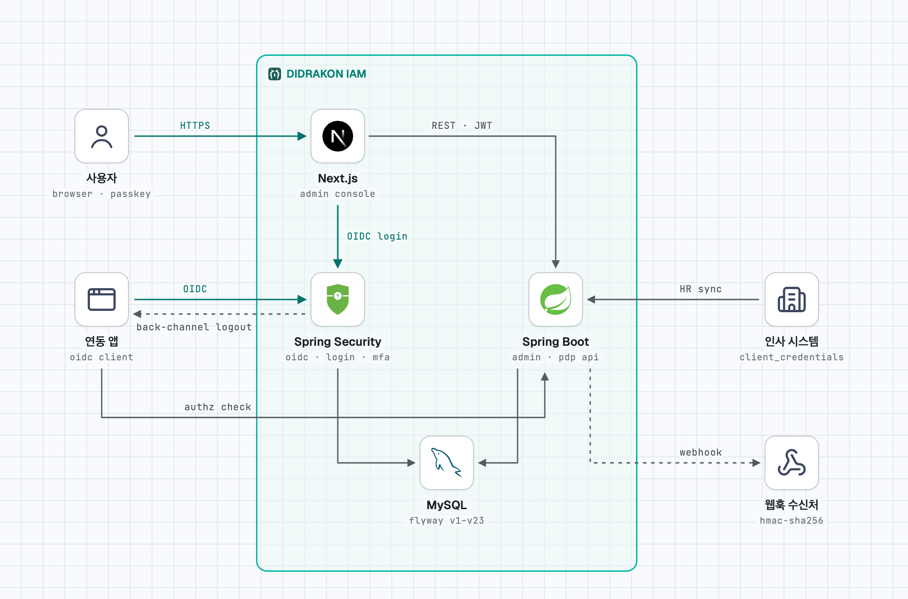

# 구조

[README](../README.md) 로 돌아가기 · 관련 문서: [보안](security.md) · [API](api.md) · [관리 콘솔](admin-console.md) · [데이터 모델](erd-v2.md)

## 시스템 구성

<picture>
  <source media="(prefers-color-scheme: dark)" srcset="architecture-dark.png">
  
</picture>

- 사용자와 연동 앱은 로그인·인가 서버에서 **OIDC** 로 로그인한다.
- 관리 콘솔·연동 앱·인사 시스템은 **관리 API·권한 판정 API** 를 부른다.
- 두 서버는 한 프로세스(`:8080`)에서 같은 MySQL 을 쓴다.
- 바뀐 내용은 **웹훅**과 **back-channel 로그아웃**으로 바깥에 알린다.

원본 그림: [architecture.html](architecture.html) ([stack-diagram](https://github.com/caru-ini/stack-diagram) 으로 만듦)

## 저장소 구성

```
didrakon-iam/
├── backend/            Kotlin + Spring Boot (Gradle 멀티모듈)
│   ├── iam-common      공통: BaseEntity, 예외, 요청 컨텍스트, hash
│   ├── iam-identity    사람(Subject·User), 조직, 그룹, IdP
│   ├── iam-authn       로그인·인가 서버(OIDC), 로컬 로그인·잠금, 세션, MFA(TOTP), 패스키, API 키
│   ├── iam-authz       권한 판정 엔진(PDP)
│   ├── iam-governance  JIT, 승인, 직무 분리, 위임, 비상 접근, 접근 재검토
│   ├── iam-risk        위험 정책·신호·평가
│   ├── iam-audit       감사 이벤트, 역할·정책 변경 이력
│   └── iam-app         실행 모듈: REST API, 보안 설정, 초기 구성, 만료 스케줄러, 웹훅, Flyway
├── admin/              Next.js 관리 콘솔
├── docs/               설계·연동 문서
├── examples/           연동 예제 앱 (스택별)
└── docker-compose.yml  로컬 MySQL 8.4
```

## 모듈 의존 방향

- `governance → authz → identity → common`
- `authn → identity`, `risk → identity`
- `authn`·`authz`·`governance` → `risk`
- `audit → authn`·`governance`·`risk`
- `app → 전체`

역방향 의존은 만들지 않는다. 아래 모듈이 위 모듈의 기능이 필요하면 아래에 인터페이스를 두고 위에서 구현한다.

- 예: 직무 분리(SoD)는 `authz` 의 `RoleGrantGuard` 를 `governance` 가 구현해 모든 역할 부여 경로에 끼운다.

## 모듈 간 연동 (도메인 이벤트)

이벤트를 내는 모듈은 받는 모듈을 모른다. 이벤트는 같은 트랜잭션 안에서 동기적으로 처리된다.

**identity 가 내는 것**

- 소속 변경·전적·조직 이동·그룹 구성원 변경
  - authz: 조직·그룹 역할 할당 동기화, 전적 처리
  - audit: `MEMBERSHIP_CHANGE`
- 사용자 상태 변경 (사용 중지·잠김·퇴사)
  - authn: 로그인 세션 종료, 발급 토큰 회수, API 키 폐기
  - authz: 퇴사면 남은 역할 할당 전부 회수

**authz 가 내는 것**

- 역할 할당 변경 → audit: `ROLE_CHANGE_HISTORY`, `ROLE_CHANGE`
- 역할 할당 회수·만료 → governance: 그 역할로 한 위임 종료
- 정책 버전 활성화 → audit: `POLICY_CHANGE_HISTORY`, `POLICY_CHANGE`

**authn 이 내는 것**

- 로그인·로그아웃·MFA → audit: `LOGIN`, `LOGOUT`

**governance 가 내는 것**

- 접근 요청·비상 접근·위임·접근 재검토
  - audit: `JIT`, `ROLE_CHANGE`
  - governance: 승인된 비상 접근 세션 시작

**risk 가 내는 것**

- 위험 정책 변경 → audit: `POLICY_CHANGE` (`RISK_POLICY`)

**여러 모듈이 함께 내는 것**

- 기준 데이터 수정·켜기·끄기 (`AdminChangeEvent`) → audit: 전후 값과 함께 `AUDIT_EVENT`
- 사용자 상태·소속·그룹 구성원·역할 할당·접근 요청·기준 데이터 변경 → app: 웹훅 아웃박스(`webhook_delivery`)에 기록하고, 커밋 뒤 전달 작업이 연동 시스템에 보낸다

## 감사 기록의 행위자

감사 기록의 행위자·IP·trace 는 `RequestContextHolder`(iam-common)에서 읽는다.

- `/api` 요청은 필터가 채운다.
- 비어 있으면 시스템 작업으로 기록된다.
- 요청에 `X-Trace-Id` 를 넣으면 감사 기록에 남고 응답 헤더로 돌아온다.

## 빌드 설정 메모

- Spring Boot BOM 의 `kotlin.version` 은 Kotlin 플러그인보다 낮다. dependency-management 플러그인이 Kotlin 컴파일러까지 낮추지 않도록 루트 `build.gradle.kts` 에서 `kotlin.version` 을 플러그인 버전으로 덮어쓴다. Kotlin 버전을 올릴 때는 `gradle/libs.versions.toml` 만 바꾸면 된다.
- 엔티티를 가진 모듈은 `kotlin-jpa`, `ksp` 플러그인만 선언하면 allOpen, JPA, QueryDSL 의존성이 루트에서 함께 적용된다.
- JDK 는 Gradle toolchain(`jvmToolchain(25)`)이 자동으로 내려받는다.
